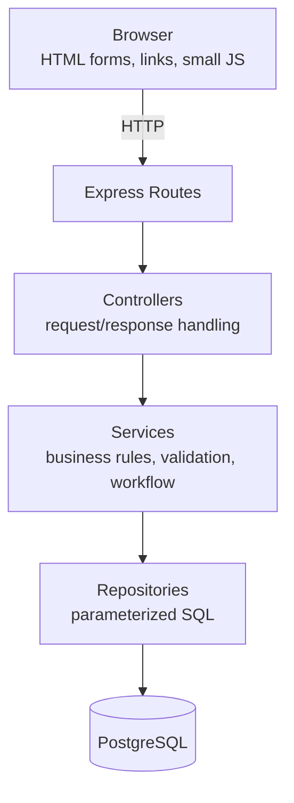
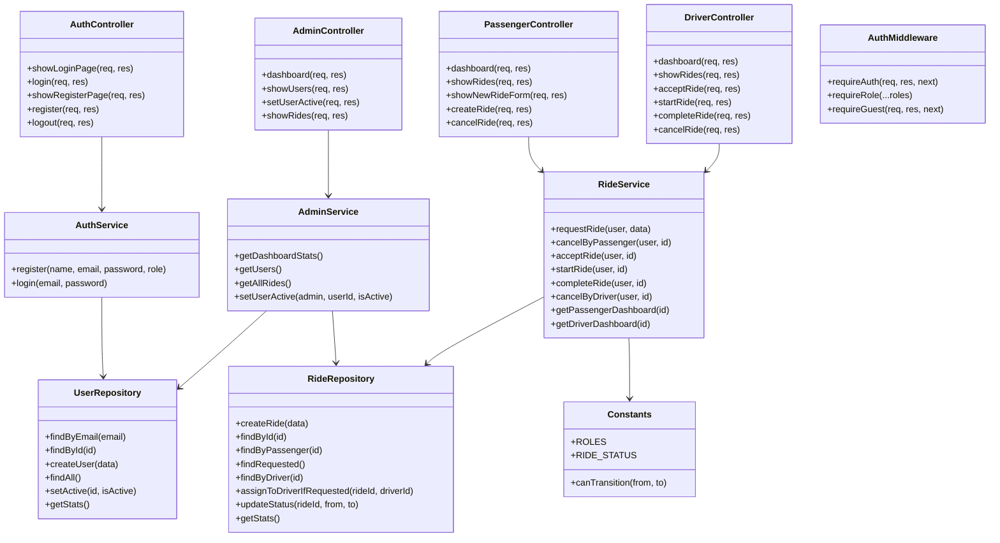
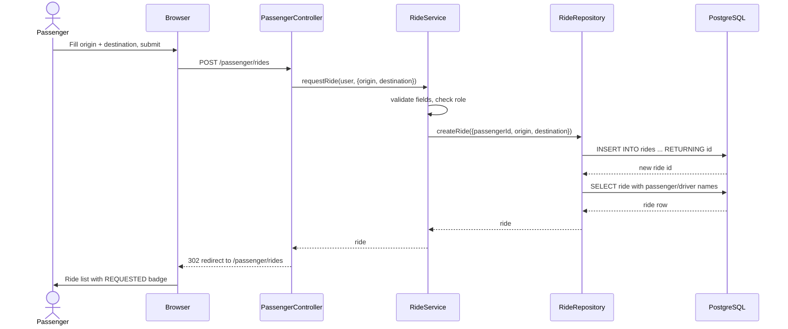
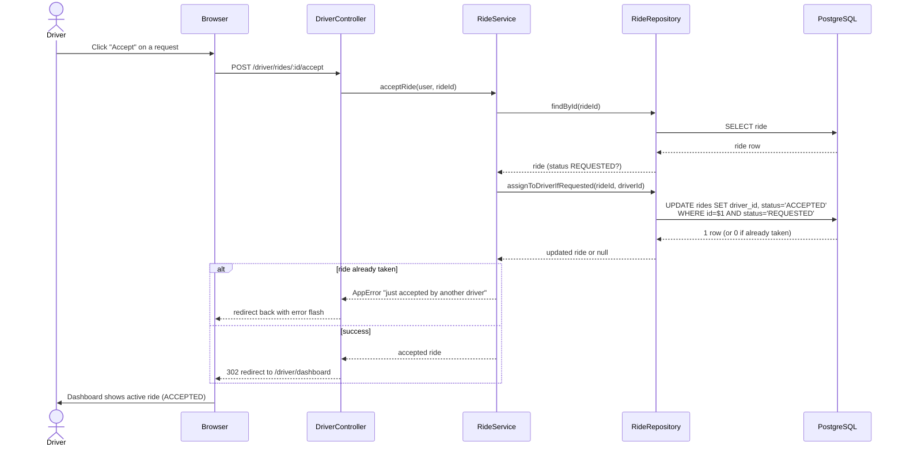
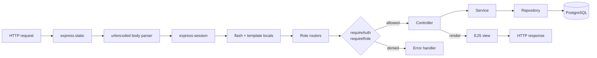

# Architecture

## 1. Overview

The application uses a simple layered architecture. Each layer only calls the
layer below it; the web layer never talks to the database directly.

Responsibilities:

| Layer        | Directory            | Responsibility                                              |
|--------------|----------------------|-------------------------------------------------------------|
| Routes       | `src/routes/`        | URL definitions, attach auth middleware per role            |
| Controllers  | `src/controllers/`   | Read request data, call services, render views or redirect  |
| Services     | `src/services/`      | Validation, permissions, ride status workflow, statistics   |
| Repositories | `src/repositories/`  | All SQL statements (parameterized)                          |
| Middleware   | `src/middleware/`    | `requireAuth`, `requireRole`, error handling                |
| Views        | `views/`             | EJS templates (presentation only)                           |
| Database     | `src/db/`            | Connection pool and setup script                            |

## 2. Module structure

- `src/app.js` – builds the Express app (static files, body parsing, session,
  flash helper, routes, error handlers)
- `src/server.js` – starts the HTTP server
- `src/constants.js` – roles, statuses and the transition table
- `src/errors.js` – `AppError` for expected errors
- `src/config.js` – reads `.env`

## 3. Class diagram (modules and their main operations)

## 4. Sequence diagram – passenger creates a ride

## 5. Sequence diagram – driver accepts a ride

## 6. Request flow through the middlewares

