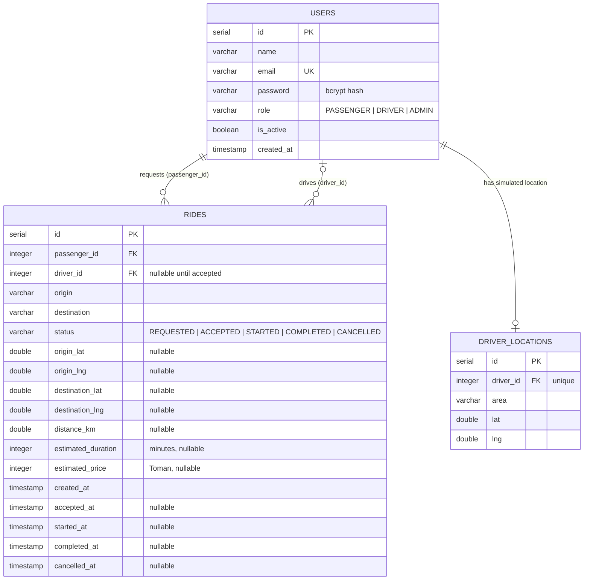

# Database Design

## 1. Overview

The system uses three tables: `users`, `rides` and `driver_locations`. No
additional tables are needed for the requested scope.

- The schema is defined in `database/schema.sql`.
- Demo data for all roles is defined in `database/seed.sql`.
- Both are executed by `npm run db:setup` (new installation).
- Existing databases are extended with `npm run db:migrate`, which applies
  the idempotent files in `database/migrations/` without destroying data.

## 2. Entity relationship diagram



Relationship descriptions:

- One user (passenger) can have many rides: `rides.passenger_id → users.id`
  (always present).
- One user (driver) can be assigned to many rides: `rides.driver_id → users.id`
  (NULL until a driver accepts).
- One driver has at most one simulated location:
  `driver_locations.driver_id → users.id`, UNIQUE.

## 3. Table: users

| Column     | Type         | Constraints                                      |
|------------|--------------|--------------------------------------------------|
| id         | SERIAL       | Primary key                                      |
| name       | VARCHAR(100) | NOT NULL                                         |
| email      | VARCHAR(150) | NOT NULL, UNIQUE                                 |
| password   | VARCHAR(100) | NOT NULL (bcrypt hash, never plain text)         |
| role       | VARCHAR(20)  | NOT NULL, CHECK in (PASSENGER, DRIVER, ADMIN)    |
| is_active  | BOOLEAN      | NOT NULL, default TRUE                           |
| created_at | TIMESTAMP    | NOT NULL, default NOW()                          |

## 4. Table: rides

| Column             | Type          | Constraints                                             |
|--------------------|---------------|---------------------------------------------------------|
| id                 | SERIAL        | Primary key                                             |
| passenger_id       | INTEGER       | NOT NULL, FK → users(id)                                |
| driver_id          | INTEGER       | FK → users(id), NULL until a driver accepts             |
| origin             | VARCHAR(200)  | NOT NULL                                                |
| destination        | VARCHAR(200)  | NOT NULL                                                |
| status             | VARCHAR(20)   | NOT NULL, CHECK in the five statuses, default REQUESTED |
| origin_lat         | DOUBLE PRECISION | Map coordinate, NULL for plain text rides            |
| origin_lng         | DOUBLE PRECISION | Map coordinate, NULL for plain text rides            |
| destination_lat    | DOUBLE PRECISION | Map coordinate, NULL for plain text rides            |
| destination_lng    | DOUBLE PRECISION | Map coordinate, NULL for plain text rides            |
| distance_km        | DOUBLE PRECISION | Route distance from the routing service, NULL if unknown |
| estimated_duration | INTEGER       | Estimated minutes, NULL if unknown                      |
| estimated_price    | INTEGER       | Estimated price in Toman, NULL if unknown                |
| created_at         | TIMESTAMP     | NOT NULL, default NOW()                                 |
| accepted_at        | TIMESTAMP     | Set when the ride becomes ACCEPTED                      |
| started_at         | TIMESTAMP     | Set when the ride becomes STARTED                       |
| completed_at       | TIMESTAMP     | Set when the ride becomes COMPLETED                     |
| cancelled_at       | TIMESTAMP     | Set when the ride becomes CANCELLED                     |

Indexes:

- `idx_rides_passenger` on `passenger_id` (passenger ride list, statistics)
- `idx_rides_driver` on `driver_id` (driver history, active ride)
- `idx_rides_status` on `status` (available REQUESTED rides)

## 4a. Table: driver_locations

| Column    | Type         | Constraints                                     |
|-----------|--------------|-------------------------------------------------|
| id        | SERIAL       | Primary key                                     |
| driver_id | INTEGER      | NOT NULL, UNIQUE, FK → users(id)                |
| area      | VARCHAR(100) | NOT NULL (e.g. "Vanak", "Tajrish")              |
| lat       | DOUBLE PRECISION | NOT NULL                                    |
| lng       | DOUBLE PRECISION | NOT NULL                                    |

These are **simulated** locations for the demo drivers, used to draw taxi
markers on the map and to pick the nearest driver. They are not real GPS
data and do not change while the application runs.

## 5. Design decisions

1. **Status as a text column with CHECK** – simple, readable in psql, and keeps
   the allowed values enforced by the database itself.
2. **Timestamps for every transition** – the history of a ride is visible
   without an extra audit table.
3. **driver_id nullable** – a ride exists before any driver is assigned,
   which matches the REQUESTED state.
4. **No separate "drivers" table** – driver-specific data is not required by
   the project scope; the role column is enough. Only the simulated location
   lives in its own small table, because it belongs to the map feature and
   keeps `users` unchanged.
5. **is_active for deactivation** – accounts are never deleted, so ride
   history stays intact for the admin pages.
6. **Nullable coordinate/estimate columns** – rides created before the map
   feature (or plain text rides) simply have NULL there; every page handles
   that case and shows "-". No data migration or backfill is needed.
7. **Migrations instead of destructive setup** – `database/migrations/` uses
   `ADD COLUMN IF NOT EXISTS`, `CREATE TABLE IF NOT EXISTS` and
   `ON CONFLICT DO NOTHING`, so an existing database can be upgraded in place
   and the script can be re-run safely.
8. **Storing the estimates** – distance, duration and price are saved with
   the ride. This keeps the historical value stable even if the pricing
   configuration is changed later.

## 6. Concurrency

Accepting a ride uses a single conditional UPDATE:

```sql
UPDATE rides
SET driver_id = $1, status = 'ACCEPTED', accepted_at = NOW()
WHERE id = $2 AND status = 'REQUESTED' AND driver_id IS NULL
```

If two drivers accept at the same moment, only the first UPDATE matches a row;
the second receives 0 affected rows and the service reports that the ride was
already taken. The same conditional-update pattern is used for every status
transition (`WHERE id = $2 AND status = $3`).

## 7. Example queries used by the application

Available requests for the driver dashboard:

```sql
SELECT ... FROM rides r
JOIN users p ON p.id = r.passenger_id
LEFT JOIN users d ON d.id = r.driver_id
WHERE r.status = 'REQUESTED'
ORDER BY r.created_at ASC;
```

Admin ride statistics:

```sql
SELECT
  COUNT(*) AS total_rides,
  COUNT(*) FILTER (WHERE status = 'COMPLETED') AS completed_rides,
  COUNT(*) FILTER (WHERE status = 'CANCELLED') AS cancelled_rides
FROM rides;
```

All queries in the application are parameterized (`$1`, `$2`, ...); no SQL
string is ever built from user input.
