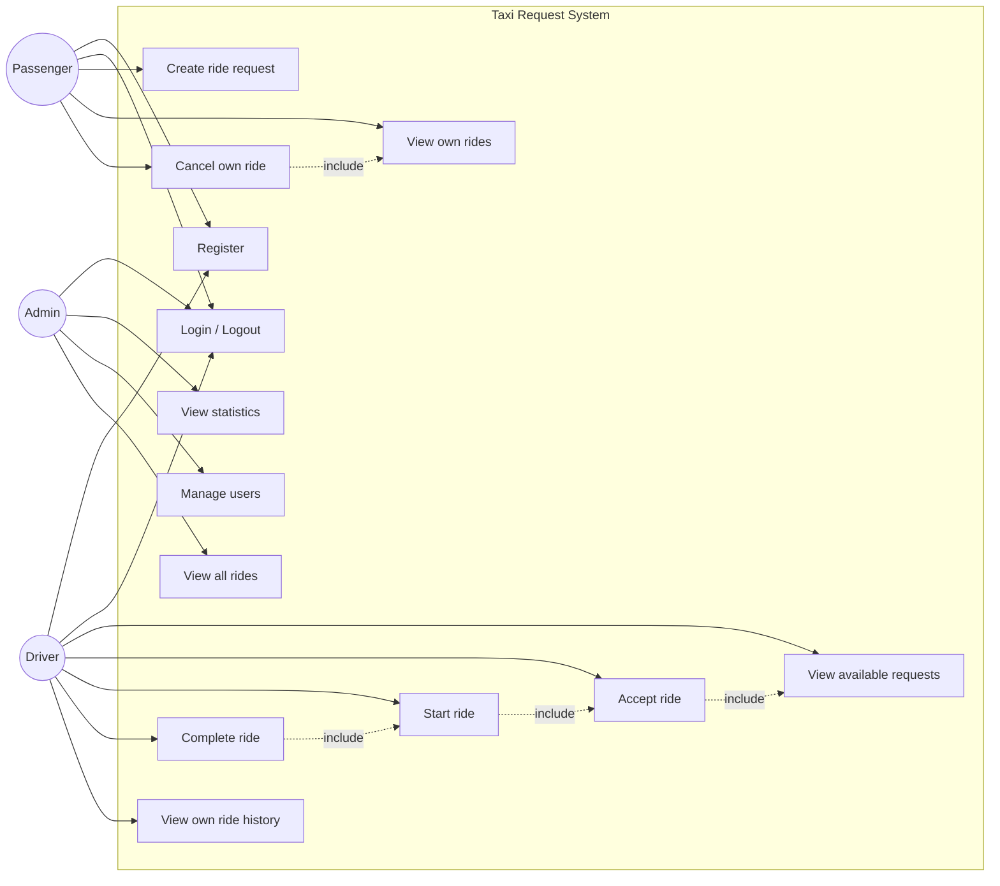
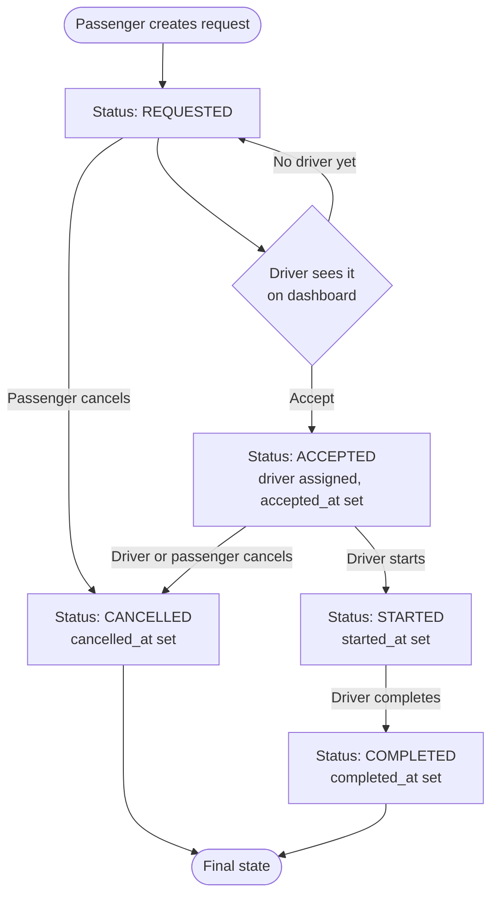
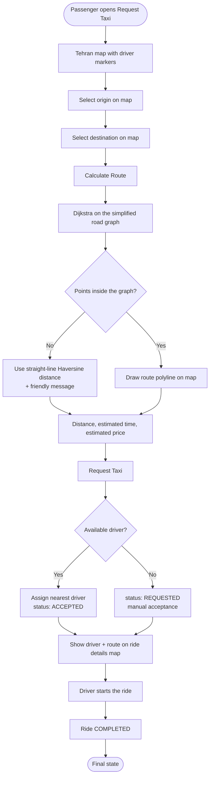

# Use Cases

## 1. Use case diagram

## 2. Use case descriptions

### UC-1 Register

- **Actor:** Visitor (future Passenger or Driver)
- **Precondition:** Not logged in
- **Main flow:**
  1. Visitor opens `/register`.
  2. Enters name, email, password and chooses a role (Passenger or Driver).
  3. System validates the input and checks that the email is not used yet.
  4. System hashes the password and stores the user.
  5. System redirects to `/login` with a success message.
- **Alternative flow:** Validation fails or email exists → the form is shown
  again with the entered values and an error message.

### UC-2 Login / Logout

- **Actor:** All roles
- **Main flow:**
  1. User opens `/login`, enters email and password.
  2. System verifies the credentials and that the account is active.
  3. System stores the user in the session and redirects to the dashboard of
     the user's role.
- **Alternative flow:** Wrong credentials or deactivated account → login page
  is shown with a friendly error message.
- **Logout:** `/logout` destroys the session and redirects to `/login`.

### UC-3 Create ride request

- **Actor:** Passenger
- **Precondition:** Logged in as an active passenger
- **Main flow:**
  1. Passenger opens `/passenger/rides/new`.
  2. Enters origin and destination.
  3. System validates both fields, creates a ride with status REQUESTED.
  4. System redirects to `/passenger/rides` showing the new request.
- **Alternative flow:** Empty field → form is shown again with an error.

### UC-5 Cancel own ride

- **Actor:** Passenger
- **Precondition:** The ride belongs to the passenger and is REQUESTED or ACCEPTED.
- **Main flow:**
  1. Passenger clicks Cancel next to the ride.
  2. System confirms the action (JavaScript confirm dialog).
  3. System changes the status to CANCELLED and stores `cancelled_at`.
- **Alternative flow:** Ride is STARTED/COMPLETED → error message, no change.

### UC-7 Accept ride

- **Actor:** Driver
- **Precondition:** Logged in as an active driver; ride is REQUESTED.
- **Main flow:**
  1. Driver sees available requests on `/driver/dashboard`.
  2. Clicks Accept on a request.
  3. System assigns the ride to the driver and sets status ACCEPTED
     (atomically, only if still REQUESTED).
- **Alternative flow:** Another driver accepted first → friendly error.

### UC-8/9 Start and complete ride

- **Actor:** Driver
- **Precondition:** Ride is assigned to this driver and in the required status.
- **Main flow:** Driver clicks Start Ride (ACCEPTED → STARTED) and later
  Complete Ride (STARTED → COMPLETED).
- **Alternative flow:** Wrong status → error message; the GUI only shows the
  button that is valid for the current status.

### UC-12 Manage users

- **Actor:** Admin
- **Main flow:**
  1. Admin opens `/admin/users`.
  2. Deactivates (or reactivates) a user.
  3. A deactivated user can no longer log in; existing sessions are rejected
     on their next request because the user row is reloaded from the database.
- **Alternative flow:** Admin tries to deactivate their own account → error.

## 3. Activity diagram – ride request lifecycle

## 4. Activity diagram – request with map and automatic driver assignment

## 5. Use case descriptions (map features)

### UC-14 Select origin and destination on the map

- **Actor:** Passenger
- **Precondition:** Logged in as an active passenger
- **Main flow:**
  1. Passenger opens `/passenger/rides/new`.
  2. The Tehran map loads with the simulated driver locations.
  3. Passenger selects "Select Origin" and clicks a point (marker A).
  4. The mode switches to destination automatically; passenger clicks a
     second point (marker B).
  5. Marker positions can be adjusted by dragging (or reset with "Reset").
- **Alternative flow:** Passenger types origin/destination text and submits
  without the map → the ride is created as REQUESTED (old workflow).

### UC-15 Calculate route and price

- **Actor:** Passenger
- **Precondition:** Both points selected
- **Main flow:**
  1. Passenger clicks "Calculate Route".
  2. System snaps both points to the nearest graph nodes and runs Dijkstra.
  3. System returns distance, estimated duration and estimated price.
  4. The shortest path is drawn as a polyline on the map.
- **Alternative flow:** Points far outside the simplified graph → straight-line
  distance with a friendly note. Invalid points → clear error message.

### UC-16 Automatic driver assignment

- **Actor:** Passenger (triggered), Driver (receives the ride)
- **Precondition:** Origin coordinates present; at least one available driver
- **Main flow:**
  1. System loads available drivers (active, has location, no active ride).
  2. System computes the Haversine distance from the origin to each driver.
  3. The nearest driver is assigned; the ride is created as ACCEPTED.
  4. The passenger sees the driver marker and the route on the ride details page.
- **Alternative flow:** No driver available → the ride stays REQUESTED and any
  driver can accept it manually.

### UC-17 View assigned ride on the driver map

- **Actor:** Driver
- **Main flow:**
  1. Driver opens the dashboard (or the ride details page).
  2. The map shows the driver's simulated location, the passenger pickup
     point, the destination and the route between them.
  3. Driver starts and completes the ride with the usual buttons.

## 6. Access matrix

| Page / action                  | Passenger | Driver | Admin |
|--------------------------------|-----------|--------|-------|
| /login, /register              | guest     | guest  | guest |
| /passenger/dashboard           | ✔         | ✘      | ✘     |
| /passenger/rides (own)         | ✔         | ✘      | ✘     |
| /passenger/rides/new           | ✔         | ✘      | ✘     |
| /passenger/rides/:id/cancel    | ✔ (own)   | ✘      | ✘     |
| /driver/dashboard              | ✘         | ✔      | ✘     |
| /driver/rides (assigned)       | ✘         | ✔      | ✘     |
| /driver/rides/:id/accept       | ✘         | ✔      | ✘     |
| /driver/rides/:id/start        | ✘         | ✔(own) | ✘     |
| /driver/rides/:id/complete     | ✘         | ✔(own) | ✘     |
| /driver/rides/:id/cancel       | ✘         | ✔(own) | ✘     |
| /admin/dashboard               | ✘         | ✘      | ✔     |
| /admin/users                   | ✘         | ✘      | ✔     |
| /admin/users/:id/active        | ✘         | ✘      | ✔     |
| /admin/rides                   | ✘         | ✘      | ✔     |
| /passenger/rides/:id (details) | ✔ (own)   | ✘      | ✘     |
| /driver/rides/:id (details)    | ✘         | ✔(own) | ✘     |
| /api/route                     | ✔         | ✔      | ✔     |
| /api/drivers                   | ✔         | ✔      | ✔     |
| /api/rides/:id                 | ✔ (own)   | ✔(own) | ✘     |
| /api/graph                     | ✔         | ✔      | ✔     |
